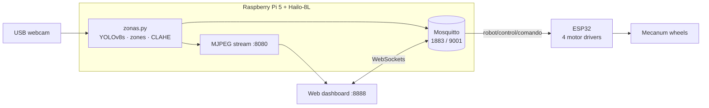

# Mecanum Person-Following Robot


Omnidirectional robot with Mecanum wheels that detects and follows a person in real time. Detection runs on a **Raspberry Pi 5** with a **Hailo-8L** AI accelerator (YOLOv8s); motion commands travel over **MQTT** to an **ESP32** that drives the four motors. A web dashboard shows the live video and allows manual control.

Built during a research stay in Industry 4.0 (Programa Delfín, Instituto Tecnológico Superior de Irapuato, June–July 2026).

<!-- TODO: add a GIF or a YouTube link of the robot following a person -->
<!--  -->

**Stack:** Python · OpenCV · GStreamer · YOLOv8 · Hailo-8L · MQTT (Mosquitto) · ESP32 (C++/Arduino) · HTML/JavaScript · Bash

---

## Architecture



| Component | Folder | Role |
|---|---|---|
| Vision | `vision/` | Runs YOLOv8s on the Hailo-8L, decides where the person is, publishes commands, serves the video stream |
| Zone logic | `vision/zones.py` | Pure functions (no hardware) that turn a bounding box into a command; covered by unit tests |
| Firmware | `firmware/control_esp32/` | Connects to Wi-Fi, finds the broker with mDNS, executes motion commands |
| Dashboard | `dashboard/` | Live video, detections, auto/manual mode and manual joystick |
| Startup | `scripts/arrancar.sh` | Starts Mosquitto, checks the camera, serves the dashboard and launches vision |

## How the robot decides where to go

The frame is split into three vertical zones (coordinates normalized 0–1):

```
| IZQ 0.00–0.25 |      CENTRO 0.25–0.75      | DER 0.75–1.00 |
```

1. Keep detections labeled `person` with confidence ≥ `0.35`.
2. For the person, compute **which zone contains the largest share of the bounding box** (`zona_dominante`). Using the share instead of the center point avoids jitter when someone stands on a border.
3. Use the **bounding box height as a distance estimate**: a person close to the camera fills more of the frame.
4. Choose the command:

| Condition | Command | Robot action |
|---|---|---|
| Box height > `0.72` | `persona_cerca` | Stop |
| Most of the box in IZQ | `persona_izquierda` | Strafe left |
| Most of the box in DER | `persona_derecha` | Strafe right |
| Otherwise | `persona_frente` | Move forward |
| No person for 10 frames | `sin_persona` | Stop |

Mecanum wheels let the robot **strafe sideways** without turning, so it keeps the camera facing the person.

The 10-frame wait (`FRAMES_ESPERA`) prevents the robot from stopping when a single frame misses the detection.

## MQTT topics

| Topic | Publisher | Subscriber | Payload |
|---|---|---|---|
| `robot/control/comando` | Vision, dashboard | ESP32 | `persona_frente`, `persona_izquierda`, `persona_derecha`, `persona_cerca`, `sin_persona`, or a manual command (`adelante`, `atras`, `lateral_izq`, `lateral_der`, `giro_izq`, `giro_der`, `diag_fd`, `diag_fi`, `diag_ad`, `diag_ai`, `stop`) |
| `robot/control/modo` | Dashboard | Vision | `auto` or `manual` |
| `robot/vision/deteccion` | Vision | Dashboard | Detection details |
| `robot/estado` | Vision | Dashboard | `modo_auto`, `modo_manual` |

In **manual** mode the vision script stops sending commands so the operator has full control.

## Hardware

- Raspberry Pi 5 + Hailo-8L AI Kit
- USB webcam
- ESP32 DevKit
- 4 DC motors with Mecanum wheels and 4 BTS7960-style drivers (RPWM/LPWM)

| Motor | RPWM | LPWM |
|---|---|---|
| Front left | 25 | 26 |
| Front right | 27 | 14 |
| Rear left | 33 | 32 |
| Rear right | 18 | 19 |

PWM: 5 kHz, 8-bit, base speed 200/255.

## Setup

### 1. Raspberry Pi

```bash
sudo apt install mosquitto mosquitto-clients xvfb
```

Enable the WebSockets listener in `/etc/mosquitto/conf.d/robot.conf`:

```
listener 1883
listener 9001
protocol websockets
allow_anonymous true
```

Install the [Hailo RPi5 examples](https://github.com/hailo-ai/hailo-rpi5-examples) and the `paho-mqtt` package in its virtual environment.

### 2. ESP32

```bash
cp firmware/control_esp32/secrets.example.h firmware/control_esp32/secrets.h
```

Edit `secrets.h` with your Wi-Fi network and the Raspberry Pi hostname, then flash `control_esp32.ino` from the Arduino IDE (libraries: `PubSubClient`, `ESPmDNS`). `secrets.h` is in `.gitignore`.

### 3. Run

```bash
./scripts/arrancar.sh
```

- Dashboard: `http://<pi-ip>:8888/dashboard_mecanum.html`
- Video stream: `http://<pi-ip>:8080`

Set `HAILO_DIR` if the Hailo examples are not in `~/Downloads/hailo-rpi5-examples`.

## Tests

The zone logic is separated from the camera and hardware so it can be tested on any computer:

```bash
python -m unittest discover -s tests -v
```

CI runs these tests on every push and fails if `secrets.h` is ever committed.

## Calibration

| Setting | File | Default | Effect |
|---|---|---|---|
| `UMBRAL` | `vision/zonas.py` | 0.35 | Minimum detection confidence (low for dim light) |
| `DISTANCIA_CERCA` | `vision/zonas.py` | 0.72 | Box height at which the robot stops |
| `FRAMES_ESPERA` | `vision/zonas.py` | 10 | Frames without a person before stopping |
| `ZONA_IZQ`, `ZONA_DER` | `vision/zones.py` | 0.25, 0.75 | Width of the side zones |
| `VEL` | `control_esp32.ino` | 200 | Motor speed (0–255) |

See [docs/troubleshooting.md](docs/troubleshooting.md) for mirrored video, MQTT and dashboard issues.

## Limitations and next steps

- Distance is estimated from box height, so it varies with the person's height and posture; a depth sensor or ultrasonic sensor would be more precise.
- Follows the first detected person; it does not re-identify a specific person.
- The broker allows anonymous connections, acceptable on an isolated network but not on a shared one. Next step: Mosquitto users and TLS.

## Team and credits

Developed as a team during the Delfín research stay.

- **Jesús Alvarado** — original repository: [jesus184xd01/Robot-Vision-computacional](https://github.com/jesus184xd01/Robot-Vision-computacional)
- **Alexander Rodríguez Del Valle** — [GitHub](https://github.com/mclovinR) · [LinkedIn](https://www.linkedin.com/in/alexander-rodriguez-del-valle/)

### My contributions

- **MQTT communication:** Mosquitto broker on the Raspberry Pi (TCP 1883 for the ESP32, WebSockets 9001 for the browser), topic design, and the connection between the vision script, the ESP32 and the dashboard
- **Web dashboard:** live MJPEG video, detection status, auto/manual mode switch and manual joystick over MQTT WebSockets
- **Startup script (`arrancar.sh`):** checks the broker and camera, serves the dashboard and runs the vision pipeline headless with `xvfb-run`, logging the output
- **Portfolio version:** credentials moved out of the code, zone logic extracted into a testable module with unit tests, CI, and documentation
